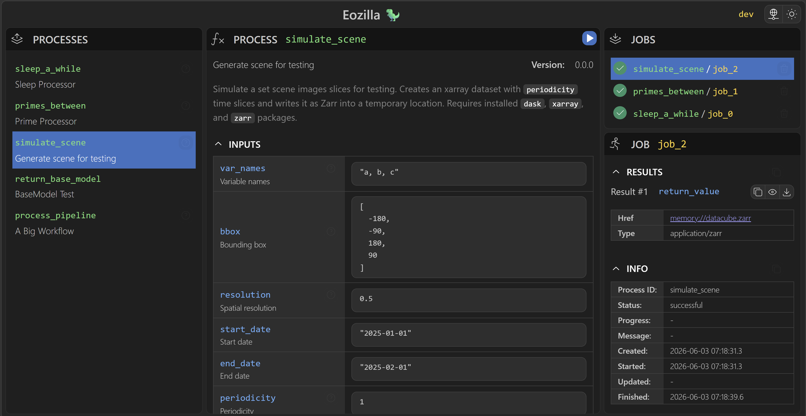

# Eozilla App

[](https://github.com/eo-tools/eozilla-app/actions/workflows/ci.yml)
[](LICENSE)
[](https://www.typescriptlang.org/)
[](https://vite.dev/)
[](https://opensource.org/licenses/MIT)

Eozilla App is a Vite + React + TypeScript frontend for
[OGC API - Processes](https://github.com/opengeospatial/ogcapi-processes)
services.

It lets you connect to a _OGC API - Processes_ service, browse processes, inspect jobs,
and review inputs, outputs, and results in a split-panel interface.

**[Try the online demo](https://eo-tools.github.io/eozilla-app/)** — no installation
required. Select **Testing Server (in-memory)** to explore the interface with
simulated processes and jobs, or connect to your own OGC API - Processes service.



## At A Glance

- Purpose: interact with OGC API - Processes services from a browser UI
- UI library: Mantine
- State management: Zustand
- Data flow: service registry and provider adapters in `src/service`
- Persistence: local app state in `src/state`
- Testing: Vitest

## What You Can Do

- Select and load a service provider
- Browse available processes
- Inspect process descriptions, inputs, and outputs
- View the job list and job details
- Inspect and reuse the complete request submitted for jobs created in this browser
- Open job results and error tracebacks
- Persist selected service and UI state locally

## Repository Map

```text
src/
  components/   UI building blocks, dialogs, and panels
  service/      OGC API - Processes models, providers, registry, and helpers
  state/        Persisted app state and related types
  store/        Zustand store, actions, and hooks
  utils/        General helpers, field utilities, and JSON/schema logic
  main.tsx      Application entry point
```

Useful entry points when exploring the code:

- `src/main.tsx` initializes providers, notifications, and the app root.
- `src/components/Main.tsx` defines the main split-panel layout.
- `src/service/index.ts` re-exports service-related modules.
- `src/store/store.ts` sets up application state.

## Getting Started

### Prerequisites

- Node.js and npm
- Optional: [Pixi](https://pixi.sh/) and a checkout of `eozilla` for team development
  and the local Eozilla Dev-Service backend, see below.

### Team Development Workspace

Eozilla App is maintained as a separate Git repository, checked out inside the
Eozilla repository. This is the standard team workspace layout:

```text
eozilla/
  eozilla-app/
```

Create the workspace with:

```bash
git clone https://github.com/eo-tools/eozilla.git
cd eozilla
pixi install
git clone https://github.com/eo-tools/eozilla-app.git eozilla-app
cd eozilla-app
npm install
```

### Install Dependencies

```bash
npm install
```

### Run The Frontend

```bash
npm run dev
```

### Run With The Local Dev Service

The `eozilla:dev` script expects the standard nested checkout described above.
From `eozilla/eozilla-app/`, run:

```bash
npm run eozilla:dev
```

In a second terminal in the same directory, run:

```bash
npm run dev
```

In the app, select the `Dev Service` provider.

## Runtime configuration

### Standalone mode

Eozilla App can run as a standalone website without Cuiman. It connects directly
to an OGC API - Processes service, which must allow requests from the app's
browser origin (CORS).

Deploy an optional `config.json` beside `index.html` to change branding and the
intended service without rebuilding:

```json
{
  "branding": {
    "title": "My App",
    "iconPosition": "before",
    "favicon": "./images/favicon.svg",
    "icon": { "emoji": "🌍" }
  },
  "service": { "apiUrl": "https://api.example.org/", "authType": "none" }
}
```

Both sections are optional. For Vite development, put the file and any images
in `public/`. For an existing deployment, add or replace them alongside the
deployed app, then reload the page.

The title appears in the browser tab and app header. To use a header image,
replace the emoji with `"icon": { "url": "./images/logo.svg" }`. Relative image
URLs resolve from the app's URL, including any hosting path prefix; a leading
`/` resolves from the site root. Omitted branding fields retain Eozilla's defaults.

Set `iconPosition` to `"before"` or `"after"` to place either an emoji or image
before or after the header title in reading order. Omitted or null uses
`"after"`; the browser-tab title and favicon are unaffected.

The `service` section selects **Configured Service** ahead of a previously saved
service and prefills the connection form. Users authenticate through the service
dialog when needed. Without this section, the app restores the saved selection
or opens the usual service dialog. Only public connection settings belong in
`config.json`; keep passwords, tokens, API keys, and client secrets out of it.

If `config.json` is absent, the app uses its defaults. Invalid configuration or
a failure to load the file produces a startup error; static hosting must return
HTTP 404 for a missing file.

### Cuiman branding

For an app launched by Cuiman, set `ClientConfig.branding` in Python to customize
the title, favicon, and header emoji or image without rebuilding. Images can be
local files or browser URLs. See the
[Cuiman customization guide](https://eo-tools.github.io/eozilla/cuiman/customization/#browser-branding-and-local-images)
for examples. Cuiman supplies the service connection and authentication;
standalone `service` settings do not apply.

In Python, use `AppBranding(icon_position="before")` to put the header icon
before the title; `"after"` is the default.

See [Runtime Configuration](https://eo-tools.github.io/eozilla/eozilla-app/runtime-configuration/)
for the full example, public service fields, image paths, defaults, and startup
errors. Branding/service-default `VITE_*` settings have moved from `.env` to
`config.json`; version/build metadata remains build-time configuration.

## Useful Scripts

```bash
npm run dev            # Start the Vite dev server
npm run eozilla:dev    # Start the local wraptile API server for testing
npm run build          # Type-check and build production assets
npm run eozilla:build  # Type-check and build production assets into eozilla cuiman
npm run tests          # Run the Vitest suite
npm run checks         # Run TypeScript type checking and ESLint
npm run format         # Format source files with Prettier
npm run preview        # Preview the production build locally
```

## Build Versioning

The footer displays the package version plus a release-relative build number:

```text
v0.1.0-dev.0 build 12
```

The package version comes from `package.json`. The build number is resolved in
this order:

1. `VITE_BUILD_NUMBER`
2. `BUILD_NUMBER`
3. The number of commits since the latest reachable public release tag
4. `0`

Public release tags are expected to use the `vX.Y.Z` format, for example
`v0.1.0`. Development or prerelease tags such as `v0.1.0-rc.1` are ignored for
the reset point.

To manually override the build number for local testing or deployment, set an
environment variable before building:

```powershell
$env:VITE_BUILD_NUMBER="12"
npm run build
```

```bash
VITE_BUILD_NUMBER=12 npm run build
```

## Working On The Codebase

- UI work usually belongs in `src/components`.
- Process and service integration work usually belongs in `src/service`.
- Shared app state and actions belong in `src/store`.
- Persisted app state belongs in `src/state`.
- Tests live next to the implementation as `*.test.ts` files.
- Substantial code changes must update the relevant canonical app documentation
  in `../docs/eozilla-app/` (overview, service providers, schema forms, or
  dynamic expressions).

## For LLMs

- Start with `src/components/Main.tsx` to understand the app layout.
- Read `src/service/*` before changing request/response models or provider
  behavior.
- Read `src/store/*` before changing cross-component state.
- Keep OGC API - Processes terminology intact:
  - A `Process` describes a capability exposed by the service.
  - A `Job` is an execution instance of a process.
- Prefer small, local changes over broad rewrites.
- If you change behavior, run `npm run checks` and `npm run tests` before
  finishing.

## License

MIT. See [LICENSE](LICENSE).
